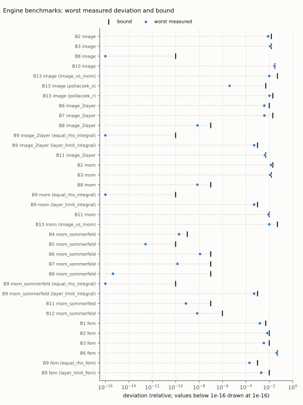
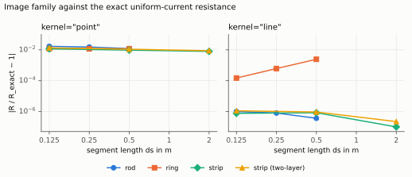
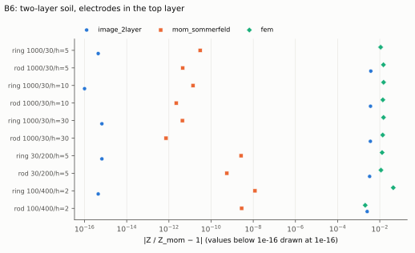

# Validation and benchmarks

<!-- Generated by scripts/generate_validation_page.py from tests/benchmarks/tolerances.py and docs/explanation/validation/measurements.json. Do not edit by hand. -->

!!! info "Generated page"

    Every number on this page comes from one run of the engine benchmark suite, measured on 2026-11-14 with groundfield 2026.11.0 (Python 3.12.3, NumPy 2.5.4, SciPy 1.18.1, numba installed: yes; Linux x86_64), and from the bounds in `tests/benchmarks/tolerances.py`. The page is written by `python scripts/generate_validation_page.py`; `tests/test_validation_page.py` checks that it matches the stored measurements and, with `--run-benchmark`, that a fresh run reproduces them.

Suite result of that run: **69 passed, 7 skipped** (`pytest tests/benchmarks --run-benchmark`; the skipped tests are combinations a benchmark does not apply to).

## What is compared with what

Each benchmark puts a world with a known answer in front of the backends. The references do not use a groundfield solver: closed forms (Weber's disc, uniformly loaded ring with elliptic integrals, uniform line currents), an independent analytic Galerkin solver for the thin-wire rod, the Tagg/Sunde series summed to $|K|^m < 10^{-17}$, `mpmath` quadrature of the three-layer kernel, and Pollaczek's line impedance. Where a benchmark compares two backends on the same discretisation (B6, B7, B10, B13), it checks the current model of one against the other, not the accuracy of either; the bound states which.

| ID | Benchmark | Case | Reference |
|---|---|---|---|
| B1 | Surface disc | disc b = 1 m on the surface (a coin 10 µm thick), homogeneous 100 Ω·m | ρ/(4b) = 25 Ω, Weber's disc, analytic |
| B2 | Rod, homogeneous soil | rod L = 3 m, a = 8 mm, top at the surface, 100 Ω·m, ds ∈ {0.5, 0.25, 0.125} m | thin-wire limit 33.1957 Ω (independent analytic Galerkin solver, Richardson on 96/192 segments; reduced-kernel end effect leaves ~0.2 % uncertainty); Sunde 33.4927 Ω for orientation |
| B3 | Ring, homogeneous soil | ring r = 2 m, a = 8 mm, z = 0.8 m, 100 Ω·m, ds ∈ {0.5, 0.25, 0.125} m | uniformly loaded thin ring + air image, closed form with complete elliptic integrals: 12.4816 Ω (exact for the thin-wire model by symmetry; Dwight 12.5429 Ω) |
| B4 | Two-layer Sommerfeld kernel | 1050 points: h_1 ∈ {0.05 … 30} m, ρ₂/ρ₁ ∈ {1/2000 … 2000}, s ∈ {0 … 5000} m, five depth pairs | exact Tagg/Sunde image series until \|K\|^m < 1e-17 |
| B5 | Three-layer Sommerfeld kernel | duplicated stacks [ρ₁, ρ₂, ρ₂] and [ρ₁, ρ₁, ρ₂] (405 points each) and the genuine [100, 1000, 50] Ω·m, h = [2, 1] m | n = 2 series; mpmath.quadosc of the remainder (30 digits) |
| B6 | Top-layer electrodes, two-layer soil | ring r = 2 m at 0.8 m and rod 0–1.5 m; 2L(1000, 30, h₁ ∈ {5, 10, 30}), 2L(30, 200, 5), 2L(100, 400, 2); ds = 0.25 m | mom on the same discretisation |
| B7 | Rod through the layer interface | rod 0–3 m through h₁ = 2 m in 2L(1000, 30) and 2L(100, 1000); ds = 0.25 m | mom: 25.6913 Ω and 64.0749 Ω |
| B8 | Two-port reciprocity | rod A 0–3 m and ring B r = 1.5 m at 0.8 m, 4 m apart; homogeneous, 2L(1000, 30, 5) and the cross-layer 2L(1000, 30, 2); ds = 0.5 m | Z_AB = Z_BA; floating-port mom 17.28197 Ω (2L h₁ = 5) and 1.43970 Ω (h₁ = 2) |
| B9 | Limits of the layered kernels | ring r = 2 m at 0.8 m: TwoLayer(ρ, ρ, h) and MultiLayer([ρ, ρ, ρ]) against homogeneous; 2L(1000, 30) with h₁ = 4 mm and 4 km against homogeneous 30 / 1000 Ω·m; ds = 0.5 m | the homogeneous result of the same backend |
| B10 | Ring with three bonded rods | ring r = 2 m at 0.5 m + three 4 m rods; homogeneous 100 and 2L(1000, 30, 5); ds = 0.25 m | mom on the same discretisation |
| B11 | Grid refinement | grid 40 × 40 m, 4 × 4 meshes, z = 0.8 m, 2L(1000, 30, 5), ds ∈ {5, 2.5, 1.25} m | the backend itself at ds / 2 (convergence contract) |
| B12 | Three-layer grid | grid of B11 in 3L[1000, 30, 200], h = [5, 10] m, ds ∈ {2.5, 1.25} m | mom_sommerfeld with every distinct pair by quadrature (tabulate=False) |
| B13 | Ring with an inductive 400 m line | ring r = 2 m at 0.8 m, isolated 400 m line (95 mm², Neumann, Sommerfeld earth return) to a 3 m rod; f ∈ {50, 1000} Hz; ds = 1 m | compare_engines(image, mom), complex Z at every frequency; the line's per-metre series impedance against the Pollaczek conductor-earth loop impedance R'_dc + Z'_P (references.pollaczek, GMR = a e^{-1/4}) |

Deviations are relative, $|Z/Z_\text{ref} - 1|$, unless the measure column says otherwise; *worst measured* is the largest value over the cases of a row (segment lengths, soils, electrodes).



## Tolerance table per backend

The cross-checks between backends run the image family with `kernel="point"`, the kernel of the `mom` family, so that they compare current models on one kernel (B8 runs every backend with its default kernel). The default line kernel of the image family is checked separately [below](#kernel-of-the-image-family).

### `image`

| Benchmark | Measure | Bound | Worst measured | Cases | Status | Note |
|---|---|---|---|---|---|---|
| B2 Rod, homogeneous soil | abs(Z/Z_ref - 1) | 1.5 % | 0.79 % | 3 | pass | point kernel |
| B3 Ring, homogeneous soil | abs(Z/Z_ref - 1) | 1.5 % | 1.2 % | 3 | pass | point kernel (10.28) |
| B8 Two-port reciprocity | abs(Z_AB/Z_BA - 1) | 1e-10 | 0 | 1 | pass |  |
| B10 Ring with three bonded rods | abs(Z/Z_ref - 1) | 3 % | 2.8 % | 2 | pass | uniform current per straight wire (10.22); target 2 % |
| B13 Ring with an inductive 400 m line (`image_vs_mom`) | compare_engines row deviation (Re and Im) | 5 % | 1.0 % | 1 | pass | inductive branch shared; galvanic part differs by the ansatz |
| B13 Ring with an inductive 400 m line (`pollaczek_x`) | abs(X'/X'_P - 1), X' = Im(Z_1600 m - Z_800 m) / 800 m at 1 kHz | 0.5 % | 8.3e-6 | 1 | pass | the two-length difference cancels the end effects; the 400 m line itself is 3.7 % (1 kHz) and 10.8 % (50 Hz) below l X'_P (finite length, l / delta = 2.5 and 0.56) |
| B13 Ring with an inductive 400 m line (`pollaczek_r`) | abs(R'/R'_P - 1), same difference | 2 % | 1.1 % | 1 | pass | converges from below with the length (-4.5 % for 400/800 m); the 400 m line is 34 % (1 kHz) and 17 % (50 Hz) below l R'_P |

### `image_2layer`

| Benchmark | Measure | Bound | Worst measured | Cases | Status | Note |
|---|---|---|---|---|---|---|
| B6 Top-layer electrodes, two-layer soil | abs(Z/Z_ref - 1) | 1 % | 0.37 % | 10 | pass | uniform-current ansatz |
| B7 Rod through the layer interface | abs(Z/Z_ref - 1) | 2 % | 0.38 % | 2 | pass | one uniform current across the interface (F02); bound met since the fix of 10.15 |
| B8 Two-port reciprocity | abs(Z_AB/Z_BA - 1) | 1e-7 | 7.3e-9 | 2 | pass |  |
| B9 Limits of the layered kernels (`equal_rho_integral`) | abs(Z/Z_ref - 1) | 1e-10 | 0 | 2 | pass | image_2layer, mom, mom_sommerfeld, cim, bem |
| B9 Limits of the layered kernels (`layer_limit_integral`) | abs(Z/Z_ref - 1) | 0.1 % | 5.1e-4 | 2 | pass | physical limit |
| B11 Grid refinement | abs(Z(ds)/Z(ds/2) - 1) | 0.6 % | 0.54 % | 2 | pass | not monotone (point kernel); 0.43 % / 0.39 % with one owner for the grid before user decision Q30 |

### `mom`

| Benchmark | Measure | Bound | Worst measured | Cases | Status | Note |
|---|---|---|---|---|---|---|
| B2 Rod, homogeneous soil | abs(Z/Z_ref - 1) | 2 % | 1.4 % | 3 | pass | point-source near field drifts under refinement (10.31); target 0.5 % with an exact near field |
| B3 Ring, homogeneous soil | abs(Z/Z_ref - 1) | 1.5 % | 1.2 % | 3 | pass | uniform current by symmetry |
| B8 Two-port reciprocity | abs(Z_AB/Z_BA - 1) | 1e-7 | 7.2e-9 | 2 | pass |  |
| B9 Limits of the layered kernels (`equal_rho_integral`) | abs(Z/Z_ref - 1) | 1e-10 | 0 | 3 | pass | image_2layer, mom, mom_sommerfeld, cim, bem |
| B9 Limits of the layered kernels (`layer_limit_integral`) | abs(Z/Z_ref - 1) | 0.1 % | 5.1e-4 | 2 | pass | physical limit |
| B11 Grid refinement | abs(Z(ds)/Z(ds/2) - 1) | 1 % | 0.86 % | 2 | pass |  |
| B13 Ring with an inductive 400 m line (`image_vs_mom`) | compare_engines row deviation (Re and Im) | 5 % | 1.0 % | 1 | pass | inductive branch shared; galvanic part differs by the ansatz |

### `mom_sommerfeld`

| Benchmark | Measure | Bound | Worst measured | Cases | Status | Note |
|---|---|---|---|---|---|---|
| B4 Two-layer Sommerfeld kernel | rel. kernel error, or SommerfeldConvergenceWarning | 1e-9 | 2.0e-10 | 1 | pass | never silent (10.47); no warning for h_1 >= 0.2 m |
| B5 Three-layer Sommerfeld kernel | rel. kernel error | 1e-10 | 2.7e-13 | 2 | pass |  |
| B6 Top-layer electrodes, two-layer soil | abs(Z/Z_ref - 1) | 1e-7 | 1.2e-8 | 10 | pass | kernel check |
| B7 Rod through the layer interface | abs(Z/Z_ref - 1) | 1e-7 | 1.4e-10 | 2 | pass | kernel check |
| B8 Two-port reciprocity | abs(Z_AB/Z_BA - 1) | 1e-7 | 4.4e-16 | 2 | pass |  |
| B9 Limits of the layered kernels (`equal_rho_integral`) | abs(Z/Z_ref - 1) | 1e-10 | 0 | 3 | pass | image_2layer, mom, mom_sommerfeld, cim, bem |
| B9 Limits of the layered kernels (`layer_limit_integral`) | abs(Z/Z_ref - 1) | 0.1 % | 5.1e-4 | 2 | pass | physical limit |
| B11 Grid refinement | abs(Z/Z_mom - 1) at ds = 5 m | 1e-7 | 7.5e-10 | 1 | pass | kernel check |
| B12 Three-layer grid | max abs(Z_ij,tab / Z_ij - 1) and abs(Z_g1,tab / Z_g1 - 1) | 1e-6 | 6.9e-9 | 4 | pass | depth-group tabulation of the reflected kernel (10.61) |

### `fem`

| Benchmark | Measure | Bound | Worst measured | Cases | Status | Note |
|---|---|---|---|---|---|---|
| B1 Surface disc | abs(Z/Z_ref - 1) | 5e-4 | 3.1e-4 | 1 | pass | observed order of convergence 1.87; discretisation of the conforming tensor mesh alone (user decision Q37; up to 2026.11 the hemisphere of the equivalent-hemisphere mesh) |
| B2 Rod, homogeneous soil | abs(Z/Z_ref - 1) | 0.1 % | 7.3e-5 | 3 | pass | solid rod with flat ends (user decision Q37); the thin-wire limit itself is uncertain at a few 1e-4 (33.185 Ω at 384 segments) |
| B3 Ring, homogeneous soil | abs(Z/Z_ref - 1) | 5e-4 | 5.7e-5 | 3 | pass | solid torus (user decision Q37) |
| B6 Top-layer electrodes, two-layer soil | abs(Z/Z_ref - 1) | 3 % | 1.3 % | 10 | pass | conforming model (user decision Q37): the deficit of mom's point kernel (10.28) |
| B7 Rod through the layer interface | abs(Z/Z_ref - 1) | 3 % | 1.1 % | 2 | pass | conforming model (user decision Q37; up to 2026.11 it raised, v0.15.0: +1092 %, silent): the deficit of mom's point kernel |
| B8 Two-port reciprocity | abs(Z_AB/Z_BA - 1) | excluded | — | — | excluded | 3-D model, run once outside the suite (stream fw4int): 0 in all three soils, its port matrix symmetric to 2.2e-16; Z_BA 0.67 / 0.96 % below the floating-port mom (h₁ = 5 / 2 m); excluded from the benchmark run for its cost: rod and ring on different axes are not axisymmetric, so fem solves them with its 3-D model (the fem3d extra; user decision Q37), 0.5 … 1.2 minutes and up to 2 GB per solve, two solves per soil |
| B9 Limits of the layered kernels (`equal_rho_fem`) | abs(Z/Z_ref - 1) | 1e-12 | 0 | 3 | pass | the conforming model meshes the canonical stack (user decision Q37) |
| B9 Limits of the layered kernels (`layer_limit_fem`) | abs(Z/Z_ref - 1) | 0.1 % | 5.0e-4 | 2 | pass | physical limit (user decision Q37) |
| B10 Ring with three bonded rods | abs(Z/Z_ref - 1) | excluded | — | — | excluded | 3-D model, run once outside the suite (stream fw4int): +0.62 % / +0.84 % against mom (error estimate 3.9e-3 / 4.3e-3; image / image_2layer +0.81 / +1.97 % above fem); excluded from the benchmark run for its cost: rods off the ring's axis are not axisymmetric, so fem solves the world with its 3-D model (the fem3d extra; user decision Q37), 2 … 3.5 minutes and up to 3.8 GB per soil (up to 2026.11 -35 % / -45 %, radii summed) |

### Deprecated names `cim` and `bem`

`cim` runs the `image` auto-dispatch and `bem` runs `mom` (deprecated aliases since 2026.11). Their rows reproduce the numbers of the backend they name.

`cim` (runs `image`):

| Benchmark | Measure | Bound | Worst measured | Cases | Status | Note |
|---|---|---|---|---|---|---|
| B8 Two-port reciprocity | abs(Z_AB/Z_BA - 1) | 1e-7 | 7.3e-9 | 2 | pass |  |
| B9 Limits of the layered kernels (`equal_rho_integral`) | abs(Z/Z_ref - 1) | 1e-10 | 0 | 3 | pass | image_2layer, mom, mom_sommerfeld, cim, bem |

`bem` (runs `mom`):

| Benchmark | Measure | Bound | Worst measured | Cases | Status | Note |
|---|---|---|---|---|---|---|
| B8 Two-port reciprocity | abs(Z_AB/Z_BA - 1) | 1e-7 | 7.2e-9 | 2 | pass |  |
| B9 Limits of the layered kernels (`equal_rho_integral`) | abs(Z/Z_ref - 1) | 1e-10 | 0 | 3 | pass | image_2layer, mom, mom_sommerfeld, cim, bem |

## Kernel of the image family

The image family assumes a uniform current per unit length on each straight wire of an electrode (a wire line of a grid, an arm of a star, a straight run of a polyline; user decision Q30 of 2026.11). For that model the resistance of a straight wire and of a ring has a closed form, so the error of the **kernel** can be separated from the error of the **ansatz**. Signed deviation from the exact uniform-current resistance (`kernel="line"` is the default since 2026.11, `kernel="point"` reproduces 0.15.0):

| Case | Exact uniform-current R | Kernel | ds = 2 m | ds = 0.5 m | ds = 0.25 m | ds = 0.125 m |
|---|---|---|---|---|---|---|
| rod 3 m from the surface, a = 8 mm, 100 Ω·m (B2 world) | 33.4997 Ω | `point` |  | −1.2 % | −1.5 % | −1.7 % |
|  |  | `line` |  | −1.0e-6 | −1.2e-6 | +1.8e-6 |
| ring r = 2 m at 0.8 m, a = 8 mm, 100 Ω·m (B3 world) | 12.4816 Ω | `point` |  | −1.2 % | −1.2 % | −1.2 % |
|  |  | `line` |  | −0.24 % | −6.1e-4 | −1.5e-4 |
| strip 10 m at 0.5 m, a = 5 mm, 100 Ω·m | 14.9411 Ω | `point` | +0.80 % | −0.96 % |  | −1.2 % |
|  |  | `line` | −1.1e-16 | −1.7e-6 |  | +7.0e-7 |
| strip 10 m at 0.5 m, a = 5 mm, two-layer 1000/30 Ω·m, h₁ = 5 m | 129.9464 Ω | `point` | +0.88 % | −1.1 % |  | −1.3 % |
|  |  | `line` | +6.1e-5 | −2.7e-5 |  | −7.8e-7 |

Against the thin-wire solution of the same rod (33.1957 Ω, the B2 reference, which lets the current vary along the rod) the line kernel stays at +0.92 % for every segment length: that is the error of the uniform-current *ansatz*, not of the kernel. The point kernel lies at −0.79 % … −0.30 %, closer by accident — its kernel error has the opposite sign and partly cancels the ansatz error.



## Two-layer soil, electrodes in the top layer (B6)

`mom` on the same discretisation is the reference: `mom_sommerfeld` integrates the same layered Green's function numerically (a kernel check), `image_2layer` replaces the computed current distribution by a uniform one (an ansatz check), `fem` solves the electrodes as solid bodies in a volume mesh (an independent method; the difference is the deficit of the point kernel of `mom`).



## Field quantities near the electrode

Impedances average the potential over the electrode, so the uniform-current ansatz of the image family errs little there; the surface potential next to a grid corner or a star tip depends on the local current density, which the ansatz gets wrong. `mom` on the same discretisation (homogeneous 100 Ω·m, 1 A, ds = 0.5 m) is the reference; touch voltage with the feet 1 m outside the corner, tip or wire (`anchor="footprint"`), step voltage from the surface point above the corner, tip or wire 1 m outwards, mesh voltage at the centre of the corner mesh. The `point` rows share the kernel of `mom` and isolate the ansatz:

| Case | Backend (kernel) | Impedance | Touch voltage, 1 m outside | Step voltage, 1 m | Mesh voltage |
|---|---|---|---|---|---|
| grid 20 m × 20 m, 4 × 4 meshes, at 0.5 m; corner | `mom` (reference) | 2.3473 Ω | 0.9377 V/A | 0.3664 V/A | 0.5305 V/A |
| | `image` (`point`) | +0.57 % | +5.1 % | −11 % | +6.1 % |
| | `image` (`line`) | +1.1 % | +6.4 % | −11 % | +8.6 % |
| star, 4 arms of 10 m, at 0.5 m; arm tip | `mom` (reference) | 5.3784 Ω | 3.4271 V/A | 0.7858 V/A | — |
| | `image` (`point`) | +3.4 % | +8.8 % | −22 % | — |
| | `image` (`line`) | +4.3 % | +10 % | −23 % | — |
| ring r = 5 m at 0.5 m | `mom` (reference) | 6.3596 Ω | 2.9730 V/A | 1.0493 V/A | — |
| | `image` (`point`) | +6.7e-16 | +1.1e-15 | 0 | — |
| | `image` (`line`) | +0.88 % | +1.8 % | +5.4e-5 | — |

The safety helpers emit `UniformCurrentFieldWarning` when a result of the image family is evaluated within 5 m of such a shape; see [the image engine](engines/image.md#field-quantities-and-the-uniform-current-ansatz).

## All measured values

??? note "Every value of the run (one row per benchmark case)"

    | Benchmark | Key | Case | Measured | Bound |
    |---|---|---|---|---|
    | B1 | `fem` | levels 0/1 | 3.1e-4 | 5e-4 |
    | B1 | `fem` | observed order | 1.87 | — |
    | B2 | `image` | ds=0.5 | 0.30 % | 1.5 % |
    | B2 | `image` | ds=0.25 | 0.63 % | 1.5 % |
    | B2 | `image` | ds=0.125 | 0.79 % | 1.5 % |
    | B2 | `mom` | ds=0.5 | 0.63 % | 2 % |
    | B2 | `mom` | ds=0.25 | 1.1 % | 2 % |
    | B2 | `mom` | ds=0.125 | 1.4 % | 2 % |
    | B2 | `fem` | ds=0.5 | 7.3e-5 | 0.1 % |
    | B2 | `fem` | ds=0.25 | 7.3e-5 | 0.1 % |
    | B2 | `fem` | ds=0.125 | 7.3e-5 | 0.1 % |
    | B3 | `image` | ds=0.5 | 1.2 % | 1.5 % |
    | B3 | `image` | ds=0.25 | 1.2 % | 1.5 % |
    | B3 | `image` | ds=0.125 | 1.2 % | 1.5 % |
    | B3 | `mom` | ds=0.5 | 1.2 % | 1.5 % |
    | B3 | `mom` | ds=0.25 | 1.2 % | 1.5 % |
    | B3 | `mom` | ds=0.125 | 1.2 % | 1.5 % |
    | B3 | `fem` | ds=0.5 | 5.7e-5 | 5e-4 |
    | B3 | `fem` | ds=0.25 | 5.7e-5 | 5e-4 |
    | B3 | `fem` | ds=0.125 | 5.7e-5 | 5e-4 |
    | B4 | `mom_sommerfeld` | max silent error | 2.0e-10 | 1e-9 |
    | B5 | `mom_sommerfeld` | duplicated stacks | 2.7e-13 | 1e-10 |
    | B5 | `mom_sommerfeld` | genuine three layers | 7.7e-16 | 1e-10 |
    | B6 | `image_2layer` | ring 1000/30/h=5 | 4.4e-16 | 1 % |
    | B6 | `mom_sommerfeld` | ring 1000/30/h=5 | 3.0e-11 | 1e-7 |
    | B6 | `image_2layer` | rod 1000/30/h=5 | 0.37 % | 1 % |
    | B6 | `mom_sommerfeld` | rod 1000/30/h=5 | 4.5e-12 | 1e-7 |
    | B6 | `image_2layer` | ring 1000/30/h=10 | 0 | 1 % |
    | B6 | `mom_sommerfeld` | ring 1000/30/h=10 | 1.4e-11 | 1e-7 |
    | B6 | `image_2layer` | rod 1000/30/h=10 | 0.36 % | 1 % |
    | B6 | `mom_sommerfeld` | rod 1000/30/h=10 | 2.2e-12 | 1e-7 |
    | B6 | `image_2layer` | ring 1000/30/h=30 | 6.7e-16 | 1 % |
    | B6 | `mom_sommerfeld` | ring 1000/30/h=30 | 4.4e-12 | 1e-7 |
    | B6 | `image_2layer` | rod 1000/30/h=30 | 0.36 % | 1 % |
    | B6 | `mom_sommerfeld` | rod 1000/30/h=30 | 7.4e-13 | 1e-7 |
    | B6 | `image_2layer` | ring 30/200/h=5 | 6.7e-16 | 1 % |
    | B6 | `mom_sommerfeld` | ring 30/200/h=5 | 2.6e-9 | 1e-7 |
    | B6 | `image_2layer` | rod 30/200/h=5 | 0.33 % | 1 % |
    | B6 | `mom_sommerfeld` | rod 30/200/h=5 | 5.6e-10 | 1e-7 |
    | B6 | `image_2layer` | ring 100/400/h=2 | 4.4e-16 | 1 % |
    | B6 | `mom_sommerfeld` | ring 100/400/h=2 | 1.2e-8 | 1e-7 |
    | B6 | `image_2layer` | rod 100/400/h=2 | 0.25 % | 1 % |
    | B6 | `mom_sommerfeld` | rod 100/400/h=2 | 2.8e-9 | 1e-7 |
    | B6 | `fem` | ring 1000/30/h=5 | 1.3 % | 3 % |
    | B6 | `fem` | rod 1000/30/h=5 | 0.63 % | 3 % |
    | B6 | `fem` | ring 1000/30/h=10 | 1.2 % | 3 % |
    | B6 | `fem` | rod 1000/30/h=10 | 0.62 % | 3 % |
    | B6 | `fem` | ring 1000/30/h=30 | 1.2 % | 3 % |
    | B6 | `fem` | rod 1000/30/h=30 | 0.61 % | 3 % |
    | B6 | `fem` | ring 30/200/h=5 | 0.85 % | 3 % |
    | B6 | `fem` | rod 30/200/h=5 | 0.57 % | 3 % |
    | B6 | `fem` | ring 100/400/h=2 | 0.75 % | 3 % |
    | B6 | `fem` | rod 100/400/h=2 | 0.59 % | 3 % |
    | B7 | `mom_sommerfeld` | 1000/30 | 4.4e-11 | 1e-7 |
    | B7 | `mom_sommerfeld` | 100/1000 | 1.4e-10 | 1e-7 |
    | B7 | `image_2layer` | 1000/30 | 0.38 % | 2 % |
    | B7 | `image_2layer` | 100/1000 | 2.2e-4 | 2 % |
    | B7 | `fem` | 1000/30 | 0.35 % | 3 % |
    | B7 | `fem` | 100/1000 | 1.1 % | 3 % |
    | B8 | `image` | homogeneous | 0 | 1e-10 |
    | B8 | `image_2layer` | top_layer | 2.2e-16 | 1e-7 |
    | B8 | `image_2layer` | cross_layer | 7.3e-9 | 1e-7 |
    | B8 | `cim` | top_layer | 2.2e-16 | 1e-7 |
    | B8 | `cim` | cross_layer | 7.3e-9 | 1e-7 |
    | B8 | `mom` | top_layer | 6.7e-16 | 1e-7 |
    | B8 | `mom` | cross_layer | 7.2e-9 | 1e-7 |
    | B8 | `bem` | top_layer | 6.7e-16 | 1e-7 |
    | B8 | `bem` | cross_layer | 7.2e-9 | 1e-7 |
    | B8 | `mom_sommerfeld` | top_layer | 4.4e-16 | 1e-7 |
    | B8 | `mom_sommerfeld` | cross_layer | 0 | 1e-7 |
    | B9 | `equal_rho_integral` | image_2layer TwoLayer(100,100,h=0.5) | 0 | 1e-10 |
    | B9 | `equal_rho_integral` | image_2layer TwoLayer(100,100,h=30) | 0 | 1e-10 |
    | B9 | `equal_rho_integral` | cim TwoLayer(100,100,h=0.5) | 0 | 1e-10 |
    | B9 | `equal_rho_integral` | cim TwoLayer(100,100,h=30) | 0 | 1e-10 |
    | B9 | `equal_rho_integral` | cim MultiLayer([100]*3) | 0 | 1e-10 |
    | B9 | `equal_rho_integral` | mom TwoLayer(100,100,h=0.5) | 0 | 1e-10 |
    | B9 | `equal_rho_integral` | mom TwoLayer(100,100,h=30) | 0 | 1e-10 |
    | B9 | `equal_rho_integral` | mom MultiLayer([100]*3) | 0 | 1e-10 |
    | B9 | `equal_rho_integral` | bem TwoLayer(100,100,h=0.5) | 0 | 1e-10 |
    | B9 | `equal_rho_integral` | bem TwoLayer(100,100,h=30) | 0 | 1e-10 |
    | B9 | `equal_rho_integral` | bem MultiLayer([100]*3) | 0 | 1e-10 |
    | B9 | `equal_rho_integral` | mom_sommerfeld TwoLayer(100,100,h=0.5) | 0 | 1e-10 |
    | B9 | `equal_rho_integral` | mom_sommerfeld TwoLayer(100,100,h=30) | 0 | 1e-10 |
    | B9 | `equal_rho_integral` | mom_sommerfeld MultiLayer([100]*3) | 0 | 1e-10 |
    | B9 | `layer_limit_integral` | image_2layer h1=0.004 | 5.1e-4 | 0.1 % |
    | B9 | `layer_limit_integral` | mom h1=0.004 | 5.1e-4 | 0.1 % |
    | B9 | `layer_limit_integral` | mom_sommerfeld h1=0.004 | 5.1e-4 | 0.1 % |
    | B9 | `layer_limit_integral` | image_2layer h1=4000 | 2.0e-4 | 0.1 % |
    | B9 | `layer_limit_integral` | mom h1=4000 | 2.0e-4 | 0.1 % |
    | B9 | `layer_limit_integral` | mom_sommerfeld h1=4000 | 2.0e-4 | 0.1 % |
    | B9 | `equal_rho_fem` | fem TwoLayer(100,100,h=0.5) | 0 | 1e-12 |
    | B9 | `equal_rho_fem` | fem TwoLayer(100,100,h=30) | 0 | 1e-12 |
    | B9 | `equal_rho_fem` | fem MultiLayer([100]*3) | 0 | 1e-12 |
    | B9 | `layer_limit_fem` | fem h1=0.004 | 5.0e-4 | 0.1 % |
    | B9 | `layer_limit_fem` | fem h1=4000 | 2.0e-4 | 0.1 % |
    | B10 | `image` | HomogeneousSoil | 1.4 % | 3 % |
    | B10 | `image` | TwoLayerSoil | 2.8 % | 3 % |
    | B11 | `image_2layer` | 5->2.5 | 0.54 % | 0.6 % |
    | B11 | `image_2layer` | 2.5->1.25 | 0.35 % | 0.6 % |
    | B11 | `mom` | 5->2.5 | 0.86 % | 1 % |
    | B11 | `mom` | 2.5->1.25 | 0.14 % | 1 % |
    | B11 | `mom_sommerfeld` | ds=5 | 7.5e-10 | 1e-7 |
    | B12 | `mom_sommerfeld` | matrix ds=2.5 | 0 | 1e-6 |
    | B12 | `mom_sommerfeld` | Z ds=2.5 | 0 | 1e-6 |
    | B12 | `mom_sommerfeld` | matrix ds=1.25 | 6.9e-9 | 1e-6 |
    | B12 | `mom_sommerfeld` | Z ds=1.25 | 1.5e-10 | 1e-6 |
    | B13 | `image_vs_mom` | worst row | 1.0 % | 5 % |
    | B13 | `pollaczek_x` | X' 1 kHz | 8.3e-6 | 0.5 % |
    | B13 | `pollaczek_r` | R' 1 kHz | 1.1 % | 2 % |

## Regenerating this page

```bash
python scripts/generate_validation_page.py --measure   # about 1–3 min
python -m pytest tests/test_validation_page.py         # page up to date
```

The benchmark tests themselves (`pytest tests/benchmarks --run-benchmark`) fail when a value leaves its bound; this page only reports them. A change of a bound or of a measured value therefore shows up here after `--measure`, and the test of the page fails until the page is regenerated.
